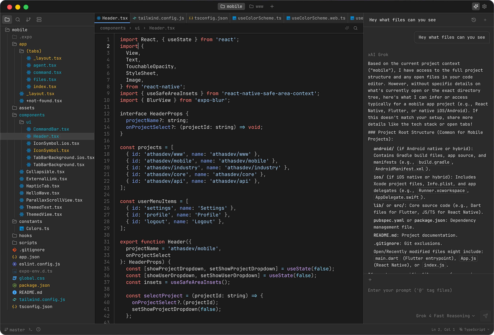

<div align="center">
  
  <h1>r0</h1>
  <p>A lightweight, cross-platform code editor, built with <a href="https://tauri.app/" title="Tauri">Tauri</a> (Rust and React) with Git support, AI agents, vim keybindings.</p>
  
</div>

## Features

- AI agents
- Git integration
- Syntax highlighting
- LSP support
- Vim keybindings
- Integrated terminal
- Database viewers
- Collaboration
- Enterprise policy controls (managed mode + extension allowlist)

## Installation

### Quick install

macOS and Linux:

```bash
curl command for download | sh
```

Windows (PowerShell):

```powershell
powershell -ExecutionPolicy ByPass -c "ommand for download | iex"
```

The install scripts detect your operating system and architecture, download the latest stable
release, and verify its SHA256 checksum when one is available. You can review the
[macOS and Linux script](http://r0-ide.vercel.app/) or
[Windows script](http://r0-ide.vercel.app/) before running it.

### Package managers

Homebrew on macOS:

```bash
brew install --cask r0
```

APT on Debian and Ubuntu:

DNF on Fedora and RHEL:


Installs from the APT and DNF repositories update with `apt upgrade` and `dnf upgrade`.

### Manual download

Prebuilt packages for macOS, Windows, and Linux are available on the
[GitHub Releases page](https://github.com/Adshkumar/r0/releases). Linux releases include native
`.deb` and `.rpm` packages, an AppImage, and a portable `.tar.gz` bundle that uses the system
WebKitGTK 4.1.

See the [installation guide](http://r0-ide.vercel.app/docs/installation) for detailed platform steps,
install locations, and uninstall instructions.

## Development

To build r0 from source, install [Node.js 24](https://nodejs.org),
[Bun 1.3.14](https://bun.sh), and [Rust](https://rustup.rs), then run:

```bash
git https://github.com/Adshkumar/r0
cd r0
bun setup
bun dev
```

`bun setup` installs the project dependencies and checks the native requirements for your
platform. See the [contributing guide](CONTRIBUTING.md) for validation commands and contribution
guidelines.

## Documentation

See the [documentation](https://r0-ide.vercel.app/docs).

## Contributing

Contributions are welcome! See the [contributing guide](CONTRIBUTING.md). Pull requests need agreement to the [Contributor License and Feedback Agreement](CONTRIBUTOR_LICENSE_AND_FEEDBACK_AGREEMENT.md).

## Support

- [Issues](https://github.com/Adshkumar/r0/issues)
- [Discussions](https://github.com/Adshkumar/r0/discussions)

